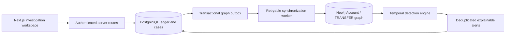

# FinGraph

A complete academic financial investigation app with PostgreSQL, Neo4j, Next.js,
an interactive graph explorer, configurable detection rules and audited alert
reviews. All supplied records are fictional.

## Fastest start: local demo

Requires Node.js 22.16+ (Node 24 LTS recommended).

```sh
npm ci
npm run demo
```

Open **http://127.0.0.1:3000**. Sign in using any investigator name and the
workspace access key printed in the terminal. The generated demo key is also
saved in `.data/demo-access-key`. The demo retains changes in `.data/demo`.

The demo runs embedded PostgreSQL (PGlite) and a saved graph projection with the
same detection algorithms. It is explicitly labeled **Local synthetic demo**.
**Neo4j is not enabled in demo mode.** There is no silent fallback when a real
database fails.

## Configured native Windows live setup

This laptop now has a dedicated PostgreSQL 18 database and Neo4j Community
2026.10.1 installation. Start the databases, application and synchronization
worker together:

```sh
npm run live
```

Open **http://127.0.0.1:3000**. Use `GRAPH_API_TOKEN` from the private
`.env.local` file to sign in. Check `/api/health`: it must report `mode: "live"`
with both `database.connected` and `graph.connected` true.

- PostgreSQL: `127.0.0.1:5433`, database `fingraph_db`, user `postgres`.
- Neo4j Bolt: `bolt://127.0.0.1:7687`, database/user `neo4j`.
- Neo4j Browser: **http://127.0.0.1:7474**.
- Passwords are in the ignored `.env.local` file. Native installation paths
  are in ignored `.data/live/runtime.json`; database files are in `.data/live`.
- The live database starts with the supplied fictional seed. Records added
  only in the PGlite demo remain in `.data/demo`; they are not migrated.

Ctrl+C stops the app and worker. To stop the database services afterwards:

```sh
npm run live:stop
```

To start only the database services, use `npm run live:db`. The native launcher
requires this machine's existing local installation metadata. On another
machine, use Docker below or configure existing PostgreSQL/Neo4j databases;
local credentials and database installations are deliberately not committed.

## Use an online Neo4j instance (Aura)

Use an empty database or an instance dedicated to FinGraph: reconciliation
updates/removes FinGraph `Account` nodes and `TRANSFER` relationships.
Update only the Neo4j settings in your ignored `.env.local` file:

```dotenv
NEO4J_URI="neo4j+s://YOUR-INSTANCE.databases.neo4j.io"
NEO4J_USERNAME="neo4j"
NEO4J_PASSWORD="YOUR-INSTANCE-PASSWORD"
NEO4J_DATABASE="YOUR-DATABASE-NAME"
FINGRAPH_DEMO="false"
```

Keep `DATABASE_URL` and `GRAPH_API_TOKEN` unchanged. The URI is the driver
connection address, not the Aura console's HTTPS page. `neo4j+s` enables TLS
with certificate validation. Store the password only in the private environment
file, not in source code or chat. Use the exact database name shown in your
Aura credentials or Query database selector; do not assume it is `neo4j`.

Stop the running app/worker before changing credentials, then check the
connection without writing any graph data:

```sh
npm run neo4j:check
```

The check reports the configured host, connectivity and record counts without
printing credentials. Once the destination is verified, this laptop's native
launcher starts local PostgreSQL, connects to the configured online Neo4j,
reconciles/synchronizes records and runs the app/worker:

```sh
npm run live
```

The launcher skips local Neo4j startup for an external connection URI. The first
start for a new graph destination reconciles the complete ledger; later starts
process only queued changes. If a graph is manually cleared or restored, run
`npm run graph:reconcile` followed by `npm run graph:sync` to repair it. Verify
`/api/health` reports live mode and both connections. Use Aura's Query tool to
inspect the online graph. `npm run live:stop` stops only the native local
services; it does not stop or delete your cloud instance.

## Full PostgreSQL + Neo4j stack

Requires Docker Desktop with Docker Compose. Stop the local demo before starting
the container app because both use port 3000.

```sh
npm ci
npm run setup
npm run stack
```

Open **http://localhost:3000**. Use the workspace access key generated by setup
(`GRAPH_API_TOKEN` in your ignored `.env.local`).

The stack starts PostgreSQL 16, Neo4j 5.26, a one-time idempotent initializer, the
application and a continuous graph synchronization worker. Database data lives
in named Docker volumes. Initialization applies the schema, fictional seed and
additive migrations, creates Neo4j constraints, synchronizes records and runs
detection. Ports are bound to the local machine.

`npm run setup` creates new local credentials only when `.env.local` does not
exist. Existing environment files are preserved. If you already have one, ensure
it includes `POSTGRES_PASSWORD`, `NEO4J_PASSWORD`, `GRAPH_API_TOKEN` and `APP_URL`
before using Compose. Initial passwords must match any existing database volumes.

Stop services without deleting data:

```sh
npm run stack:stop
```

Docker is not installed on the development machine used for this implementation,
so container startup has not been executed there. The app build, local demo and
HTTP/browser workflows have been tested separately.

## Use your team's existing databases

1. Copy `.env.example` to `.env.local`; enter the actual PostgreSQL/Neo4j
   credentials. Set a random `GRAPH_API_TOKEN` of at least 32 characters.
2. Set `APP_URL` to the browser-facing origin (for example
   `http://localhost:3000`). Browser mutations are checked against this origin.
3. If the PostgreSQL schema and seed are already installed, apply only the
   additive migrations and graph setup:

```sh
npm run graph:setup
npm run graph:sync
npm run graph:detect
npm run graph:worker
```

Run `npm run dev` in another terminal. For a fresh empty database, use
`npm run database:init` once, then start the worker and application. None of
these scripts drop the existing ledger or recreate your friend's database.

## Completed application features

- **Dashboard:** current ledger metrics, transaction statuses, alert counts,
  customer/account totals, daily activity and recent transfers.
- **Transactions:** search, filters, sorting, pagination, ID copy, transaction
  details and idempotent synthetic transfer entry. Entry queues graph updates in
  the same SQL commit.
- **Graph Analysis:** directed draggable graph, account and date filters, hop
  limits, zoom/pan/reset, account/transfer selection, evidence highlighting,
  synchronization, failed-event retries and detection run history.
- **Alerts:** searchable/filterable queue, risk ordering, linked transactions,
  graph evidence, review status changes, case notes and audit history.
- **Detection Rules:** enable/disable all seven supported detectors and edit
  validated thresholds. Changes are audited and take effect on the next run.
- **Access:** shared investigator access key, signed eight-hour HttpOnly session,
  sign-out, origin validation, optimistic concurrency on reviews/rules and
  authenticated APIs. The operator key is never embedded in client JavaScript.

## Architecture



PostgreSQL owns financial records. Neo4j is an eventually consistent projection.
Detection runs refuse a stale projection. Unique IDs, queue row locks, graph
constraints and retryable writes protect synchronization. Alert evidence retains
the actual account IDs, transaction IDs, amounts, timestamps and effective rule
configuration. Decimal amounts use exact bigint arithmetic in the engine.

| Detector | Main signal |
| --- | --- |
| Circular fund routing | Chronological simple cycles with retained value |
| Multi-hop layering | Long paths with short hop delays and limited loss |
| Rapid pass-through | Incoming funds quickly allocated to outgoing transfers |
| Structuring / smurfing | Repeated near-threshold transfers into one account |
| Shared intermediary | Distinct fan-in followed by distinct fan-out |
| Split transfers | Rapid dispersal to distinct counterparties |
| Dormant-account spike | Large outflow after a measured inactivity gap |

The split-transfer rule starts disabled because that is the original seed
configuration. The existing dormant-account demo descriptions conflict with the
seed's timestamps; detection correctly uses actual transaction/account history.
See [backend details and limitations](docs/NEO4J_BACKEND.md).

## API reference

All data endpoints accept the signed browser session or
`Authorization: Bearer <GRAPH_API_TOKEN>`. Session mutations require a matching
Origin. Public health endpoints return connectivity only.

| Method | Endpoint | Purpose |
| --- | --- | --- |
| POST / GET / DELETE | /api/auth/session | Sign in, inspect session, sign out |
| GET | /api/dashboard/stats | Dashboard aggregates |
| GET / POST | /api/transactions | Explore ledger / create synthetic transfer |
| GET | /api/transactions/[id] | Transfer details and linked alerts |
| GET | /api/accounts | Account options |
| GET | /api/accounts/[id] | Account and recent activity |
| GET | /api/graph | Bounded neighborhood and projection status |
| GET / POST | /api/graph/sync | Queue status / process a batch |
| POST | /api/graph/sync/retry | Requeue failed/dead events |
| GET / PATCH | /api/detection/rules, /api/detection/rules/[id] | Read / change rules |
| POST | /api/detection/run | Evaluate and optionally persist findings |
| GET | /api/alerts | Paginated filtered alert queue |
| GET / PATCH | /api/alerts/[id] | Evidence / audited review and notes |
| GET | /api/system | Database status and recent detection runs |
| GET | /api/health, /api/graph/health | Sanitized health probes |

## Testing

```sh
npm test
npm run typecheck
npm run lint
npm run build
```

The default suite runs **48 tests**, with eleven additional database integration
tests available by opt-in. All eleven integration checks passed during the audit
using isolated PostgreSQL 18 and Neo4j Community 2026.10.1 services.
The suite checks all seven detectors, negative cases,
eligibility, currencies, graph bounds, input/authentication, SQL rollback,
review/audit workflows, rule changes and idempotent transaction creation.
See [audit results and remaining limits](docs/AUDIT.md), including concurrent
worker tests, the fixes found during review, and the two inconsistent seed dates.

With `npm run demo` running in another terminal:

```sh
npm run test:smoke
```

The smoke test is intentionally restricted to local demo mode. It creates a
small fictional transfer, updates a fictional review, checks rule edits, verifies
sync/detection/deduplication and tests session protection. Demo changes persist.

Browser checks cover sign-in, the dashboard, running graph detection, saved case
notes/status, transaction entry and the connected rule UI. Lint retains the
existing non-blocking TanStack Table/React Compiler compatibility warning.

## Project files

- `database/schema.sql`, `seed.sql`, `verify.sql`: original PostgreSQL work.
- `database/graph.sql`: graph outbox, triggers, detection runs and fingerprints.
- `database/app.sql`: investigator notes, audit log, transfer request identities.
- `database/detection.cypher`: bounded native Cypher traversal examples.
- `src/lib/graph/`: projection synchronization and detection engine.
- `src/lib/workflows.ts`: review, rule and transfer services.
- `src/app/`: working pages and server routes.
- `scripts/`: setup, initialization, worker, demo and smoke verification.

## Practical limits

This is an academic prototype, not a banking ledger or production AML system.
Shared-key sign-in provides a small-team demo workspace, not individual verified
accounts or enterprise roles. FIFO pass-through attribution is a heuristic.
Graph analysis is bounded to 5,000 accounts, 10,000 edges, six hops and explicit
work/result budgets. Large datasets need scoped database-side queries.

No real-world detection accuracy or regulatory compliance is claimed. Use only
synthetic records for demonstrations.
